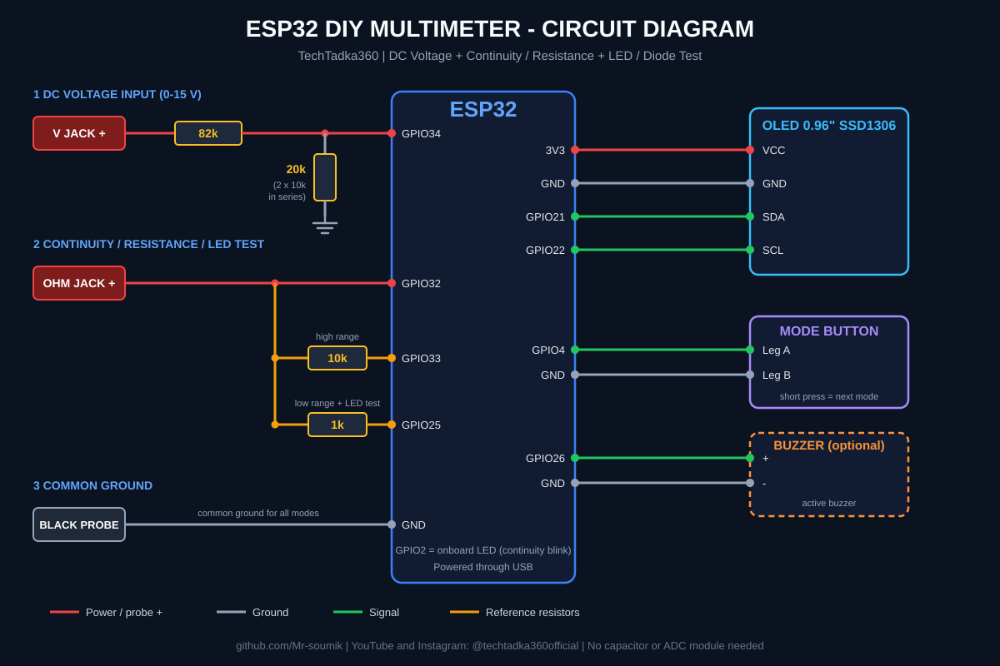

<div align="center">

# ⚡ ESP32 DIY Multimeter

### A 3-mode smart multimeter built with just an ESP32 and a 0.96" OLED. No ADS1115, no INA219, no capacitor.


[](https://www.youtube.com/@techtadka360official)
[](https://www.instagram.com/techtadka360official)
[](https://www.facebook.com/share/1EkKAJNLdB/)


### 🎬 [Watch the full build video on YouTube](YOUR_VIDEO_LINK_HERE)

</div>

---

## 📖 Overview

This project turns an ordinary ESP32 into a working digital multimeter. It uses only the ESP32's built-in ADC, a few resistors and a push button. A custom OLED interface with a startup animation, large readable digits and a smooth animated bar graph makes it look and feel like a real instrument.

Software filtering (trimmed-mean sampling and adaptive smoothing) keeps the readings steady, so **no external ADC module and no filter capacitor are needed**.

## ✨ Features

| Mode | What it does |
|------|--------------|
| ⚡ **DC Voltage** | Measures 0-15 V. Works for AA cells, Li-ion, 9 V, 12 V and USB 5 V supplies |
| 🔔 **Continuity + Resistance** | Beeps below 50 Ω and shows the resistor value on screen (about 30 Ω to 100 kΩ) |
| 💡 **LED / Diode Test** | Shows if an LED is good, its forward voltage (Vf), and the likely LED color or diode type |

**Extra highlights**
- Professional boot animation with the TechTadka360 branding
- Single push button to switch modes, with wipe transitions
- Large custom fonts and a smooth, gliding segmented bar graph
- Adaptive filtering: calm when steady, fast when the voltage really changes
- Zero lock: shows a clean `0.00 V` when the probes are open
- Serial debug output at 115200 baud

## 🧰 Hardware Required

| Qty | Component |
|-----|-----------|
| 1 | ESP32 Dev Board |
| 1 | 0.96" OLED display (SSD1306, I2C) |
| 1 | Push button |
| 1 | 82 kΩ resistor |
| 3 | 10 kΩ resistors (two in series make the 20 kΩ) |
| 1 | 1 kΩ resistor |
| 1 | Breadboard + jumper wires |
| 1 | Red and black test probes |
| 1 | Active buzzer (optional) |

## 🔌 Circuit Diagram



### Pin Map

| ESP32 Pin | Connects To |
|-----------|-------------|
| GPIO21 | OLED SDA |
| GPIO22 | OLED SCL |
| 3V3 / GND | OLED VCC / GND |
| GPIO4 | Mode button (other leg to GND) |
| GPIO34 | V jack, through the 82k resistor. 20k goes from GPIO34 to GND |
| GPIO32 | Ohm jack (red probe) |
| GPIO33 | 10k reference resistor to the Ohm jack node |
| GPIO25 | 1k reference resistor to the Ohm jack node |
| GPIO26 | Buzzer + (optional, - to GND) |
| GPIO2 | Onboard LED (blinks with continuity) |
| GND | Black probe (common for all modes) |

### Wiring Summary

1. **OLED:** VCC to 3V3, GND to GND, SDA to GPIO21, SCL to GPIO22.
2. **Button:** one leg to GPIO4, the other to GND.
3. **Voltage input:** red probe to the 82k resistor, then to GPIO34. Connect 20k (two 10k in series) from GPIO34 to GND.
4. **Ohm / LED input:** red probe to GPIO32. Connect 10k from GPIO33 to GPIO32, and 1k from GPIO25 to GPIO32.
5. **Black probe:** to ESP32 GND.
6. **Buzzer (optional):** + to GPIO26, - to GND.

## 💻 Software Setup

1. Install the [Arduino IDE](https://www.arduino.cc/en/software) and add **ESP32 board support** (Boards Manager, search `esp32` by Espressif).
2. Install these libraries from the Library Manager:
   - `Adafruit SSD1306`
   - `Adafruit GFX Library`
3. Open `ESP32_Multimeter.ino`, select **ESP32 Dev Module** and your COM port.
4. Upload, then open the Serial Monitor at **115200 baud** if you want debug output.

```bash
git clone https://github.com/Mr-soumik/ESP32-Multimeter.git
```

## 🎮 How to Use

| Action | Result |
|--------|--------|
| Short press the button | Next mode: Voltage, Continuity, LED test |
| **Voltage mode** | Black probe to the negative side, red probe to the positive side |
| **Continuity mode** | Touch the probes across a wire or component. It beeps below 50 Ω |
| **LED mode** | Red probe on the LED's longer leg (anode), black on the shorter leg (cathode) |

## 🎯 Calibration (2 minutes)

1. Open the Serial Monitor with the probes open. `GPIO34` should read near 0 mV.
2. Measure a battery with a trusted meter and compare it with the OLED reading.
3. Adjust these constants at the top of the code:

| Constant | Purpose |
|----------|---------|
| `V_CAL` | Scale factor. If the display reads 3% low, set `1.03f` |
| `PIN_OFFSET_MV` | Zero error of GPIO34 with open probes |
| `V_DEADBAND` | Voltages below this show `0.00 V` (default 0.90 V) |
| `R_BOTTOM` | Set to `10000.0f` if you used a single 10k instead of 20k |

## ⚙️ How It Works

- **Voltage:** a resistor divider (82k and 20k) scales the input down so 15 V becomes about 3 V at the ESP32 pin. The code reads 64 samples, drops the noisy ones, averages the rest, and multiplies by the divider ratio.
- **Resistance:** the unknown resistor forms a divider with a known reference (10k, or 1k for low values). The ESP32 reads the middle voltage and calculates `R = Rref × V / (3.3 V - V)`.
- **LED / Diode:** current flows through the 1k resistor into the LED, and the code reads the forward voltage. The voltage tells whether it is a good LED, a silicon diode or a Schottky diode.

## ⚠️ Specifications and Safety

- DC voltage only, **maximum 15 V**. The display shows `OVER` near the limit.
- Accuracy depends on the ESP32 ADC. With calibration, expect readings that are good for hobby use, not lab-grade measurements.
- **Never connect mains (AC) voltage.** The ESP32 is not isolated.
- Power the circuit only from USB. Do not connect the measured source to the ESP32 supply.

## 🛠️ Troubleshooting

| Problem | Fix |
|---------|-----|
| OLED stays blank | Check SDA/SCL wires and that the I2C address is `0x3C` |
| Voltage jumps with probes open | Make sure the 20k resistor really connects GPIO34 to GND |
| Small voltage shows with probes open | Raise `V_DEADBAND` slightly or set `PIN_OFFSET_MV` |
| Reading is a few percent off | Calibrate `V_CAL` against a trusted meter |
| No beep | Check the buzzer polarity and that it is an **active** buzzer on GPIO26 |

## 📁 Project Structure

```
ESP32-Multimeter/
├── ESP32_Multimeter.ino
├── circuit_diagram.svg
├── circuit_diagram.png
├── images/
│   └── demo.jpg
└── README.md
```

## 🚀 Future Ideas

- Auto-ranging resistance and capacitance mode
- Hold button and min/max recording
- Battery and data logging over Wi-Fi

## 🌐 Connect With Me

| Platform | Link |
|----------|------|
| ▶️ YouTube | [@techtadka360official](https://www.youtube.com/@techtadka360official) |
| 📸 Instagram | [@techtadka360official](https://www.instagram.com/techtadka360official) |
| 👍 Facebook | [TechTadka360](https://www.facebook.com/share/1EkKAJNLdB/) |
| 💻 GitHub | [Mr-soumik](https://github.com/Mr-soumik) |
| 🎬 Build Video | [Watch on YouTube](YOUR_VIDEO_LINK_HERE) |

## 🤝 Contributing

Ideas, bug reports and pull requests are welcome. Fork the repo, make your change and open a pull request.

## 📄 License

Released under the MIT License. Free to use, modify and share, with credit to **TechTadka360**.

<div align="center">

### ⭐ If this project helped you, give it a star and share it with a fellow maker!

**Don't wait for perfect tools. Build with what you have, and keep learning.** 💪

Made with ❤️ by **TechTadka360**

</div>
